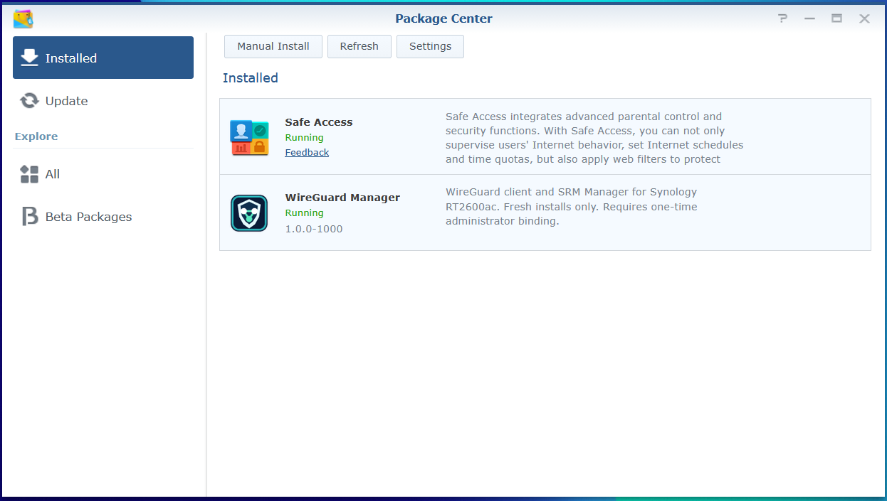
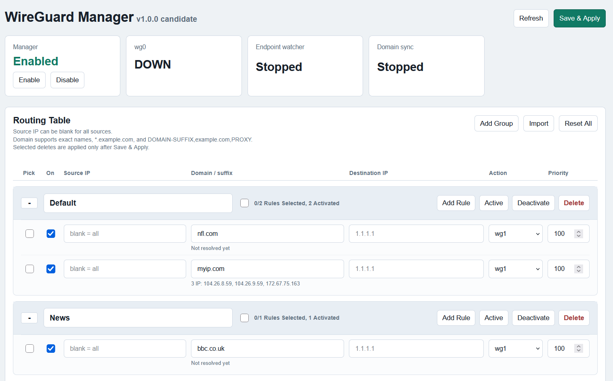

# Synology RT2600ac WireGuard Client

Version **1.0.0** (`1.0.0-1000` in SRM Package Center) is a fresh-install WireGuard client for the Synology RT2600ac. The downloadable `.spk` includes the ARMv7 WireGuard binaries, the Manager, and an SRM desktop App. No separate MSYS2 build is needed on the user's computer.

**Tested Router firmware:** SRM 1.3.2-9366 Update 3 on the RT2600ac.

The exact package offered in this release was installed and exercised on one recoverable RT2600ac on 16 October 2026. The owner reported that fresh installation, SRM administrator binding, profile import, profile and Manager activation, a selected routing rule, ordinary Internet access, reboot persistence, and guest isolation passed. It has **not** been tested on a second independent Router or independently security-audited. Back up your Router before using it.

## Screenshots

**SRM Package Center:** WireGuard Manager installed and running as version `1.0.0-1000`.



**Manager interface:** example routing-rule screen. The status indicators reflect the test state when this screenshot was taken, not the expected status of every installation.



## Download and verify

Under **Releases → v1.0.0 → Assets**, download `WireGuardManager-1.0.0-1000-RT2600ac.spk`. Do not use GitHub's automatic “Source code (zip)” or “Source code (tar.gz)” download as an installer.

The expected SHA-256 of the SPK is:

```text
31f2026fbfa7d49e3978ad966072d07dcc4dbd3f6ce0915923e5ff9791b45a35
```

On Windows PowerShell, check the downloaded file with:

```powershell
Get-FileHash -Algorithm SHA256 -LiteralPath 'C:\path\to\WireGuardManager-1.0.0-1000-RT2600ac.spk'
```

Continue only if the hash matches exactly.

## Requirements

- Synology RT2600ac, SRM, a writable `/volume1`, and a working TUN device.
- An SRM administrator account and HTTPS access to SRM.
- Root SSH access for one-time administrator binding.
- A separate way to recover Router access and settings if policy routing is misconfigured.

This version supports one primary `lbr0` IPv4 LAN. It is **not an upgrade package**: installation refuses an existing `/volume1/WireGuard` tree or pre-existing Manager state instead of overwriting private keys or configuration.

## Install on a new Router

1. Back up SRM settings and any existing VPN material. Confirm there is no earlier WireGuard Manager installation under `/volume1/WireGuard`.
2. In SRM **Package Center → Manual Install**, select the verified `.spk`. Installation starts with Manager disabled, no profiles, and no routing rules.
3. Connect to the Router by SSH as root and bind the SRM administrator who will use the App, replacing the placeholder with the actual SRM username:

   ```sh
   /bin/busybox sh /var/packages/WireGuardManager/target/share/configure-admin.sh YOUR_SRM_ADMIN_USERNAME
   ```

   Expect `admin_binding=PASS`. The account must belong to SRM's `administrators` group. The binding command does not display private keys or the Web token.
4. Sign in to SRM **over HTTPS** as that administrator, then open **WireGuard Manager** from the SRM desktop. The Manager is reached through an SRM-authenticated HTTPS gateway; direct HTTP access to port 8099 is intentionally refused.
5. Use **Add Profile** to upload a WireGuard `.conf`. Imported profiles start **Off**. Review the automatically selected interface name and table, then **Save while Off**. Turning a newly imported profile On in that first save is intentionally rejected.
6. Turn the saved profile **On**, save, and then **Enable Manager**. Wait for each apply to finish before changing another setting.
7. Start with a rule for one test client or website. Confirm the expected exit IP while SRM and ordinary Internet remain reachable. Only then add more rules.

Keep VPN `.conf` files, private keys, token-bearing URLs, and Router backups out of public issues and screenshots.

## Wildcard domains and DNS learning in v1.0.0

The v1.0.0 fresh installer leaves **Event DNS learning Off**. Without it, `*.example.com` can pre-resolve the base domain and configured Suffix Prefixes, but it will not automatically learn arbitrary new subdomains. After enabling Manager, activate the included learner once from a root SSH session:

```sh
M=/volume1/WireGuard/manager
"$M/bin/manager-control.sh" enable-event-dns
"$M/bin/event-dns-engine.sh" status
```

The first command reapplies Manager-owned routing and may briefly interrupt selected VPN traffic. Proceed only when you have a recovery connection. Successful status reports `enabled=1`, `worker=running`, `capture=available`, and `managed_map=present`. No additional Save & Apply is needed. If `tcpdump` is unavailable, activation refuses the change; do not assume wildcard learning is active.

An enabled `*.example.com` rule matches the base domain and subdomains at any depth, but the Router can learn only IPv4 A answers it actually observes on its `lbr0` LAN. Client-side encrypted DNS, pre-existing DNS caches, and IPv6-only answers are not covered. Suffix Prefixes are for a few predictable hostnames, not number ranges or automatic enumeration. The rule editor's “Not resolved yet” text does not show event-learned subdomain IPs; those are recorded under `manager/run/event-dns/ledger` on the Router. Do not publish that runtime file without reviewing it for private browsing information.

## Operation and recovery

- Turning a rule **Off** and saving stops that rule; changing its action to WAN is not required. Deleting a rule also removes its saved configuration.
- **Disable Manager** removes Manager-owned routing policy. Allow the apply job to complete before stopping or uninstalling the package.
- The package stop action disables policy and stops its Web service. On restart it restores only a previously enabled state. If a stop or apply fails, do not force-remove lock files or reboot repeatedly; inspect the Manager status first.
- Uninstall refuses an enabled Manager. Once disabled, uninstall leaves `/volume1/WireGuard` and the private SRM state in place for recovery. This also means reinstalling is **not** an automatic reset: preserve or migrate those directories through a reviewed procedure. Never delete private keys or backups merely to make an installer pass.
- In-place upgrade and automatic adoption of an earlier Manager installation are not supported in v1.0.0.

## Scope and limitations

- RT2600ac ARMv7 and one `lbr0` IPv4 LAN are the supported target. Other Synology models and multiple-LAN configurations are unverified.
- Up to ten profiles may be configured, with at most three On at once.
- Domain-based routing requires the Router to observe and learn relevant DNS answers; it cannot guarantee coverage for traffic using an unseen resolver or previously cached addresses.
- This is a single-Router hardware acceptance, not a security certification or a guarantee of compatibility with every SRM setup.

## Licensing and source availability

[LICENSE-MANAGER.md](LICENSE-MANAGER.md) permits downloading and installing unmodified Manager-specific files but does not grant modification or independent redistribution rights. Third-party WireGuard components retain their own open-source licenses and rights; see [THIRD_PARTY.md](THIRD_PARTY.md). The complete third-party source snapshots, notices, and relinkable objects provided with this release are included inside the SPK under `third_party/`.
