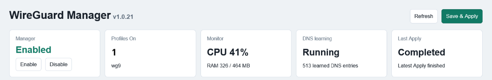
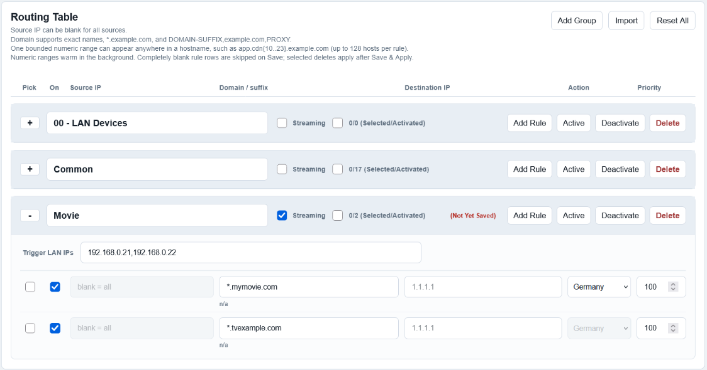
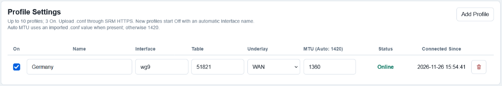
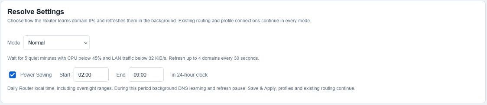
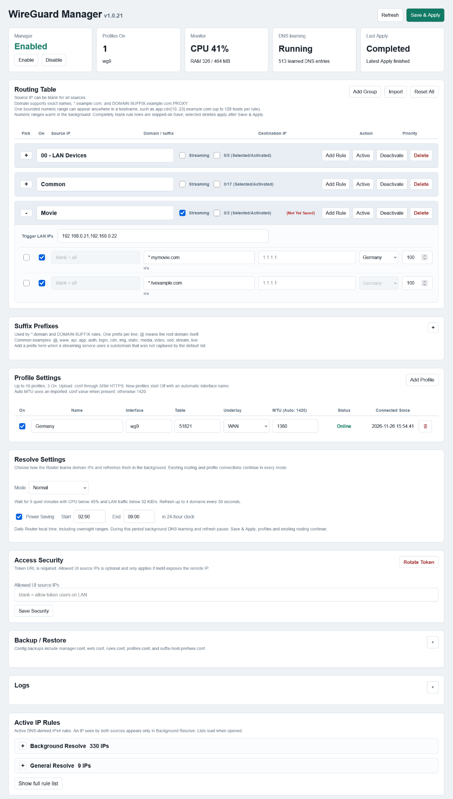

# WireGuard Client for Synology RT2600ac

**Advanced WireGuard VPN management, integrated directly into Synology Router Manager (SRM).**

Manage multiple VPN connections, control which traffic uses a VPN, and build flexible routing policies from a native SRM desktop app. WireGuard Manager combines selective routing, automatic DNS learning, streaming-specific routing controls and adaptive background DNS management in a single installable SPK.

The package includes the ARMv7 WireGuard components, Manager service and SRM desktop app. No separate WireGuard compilation or installation is required.

[](https://github.com/ICHTBAA/WireGuard-Client-for-Synology-RT2600ac-Router/releases/tag/v1.0.21-1133)


**[Download WireGuard Manager v1.0.21-1133](https://github.com/ICHTBAA/WireGuard-Client-for-Synology-RT2600ac-Router/releases/tag/v1.0.21-1133)** · [What's new](#whats-new-in-v1021) · [Installation](#installation)



## Key features

- **Native SRM integration** — manage WireGuard directly from the SRM desktop.
- **Multiple VPN profiles** — configure up to 10 profiles and keep up to 3 active simultaneously.
- **Selective routing / split tunneling** — route traffic by LAN source, destination IPv4 address, exact domain or domain suffix.
- **Streaming groups** — use DNS-triggered, temporary device-specific VPN routing for streaming services.
- **Smart DNS learning** — five Resolve modes, persistent learned hostnames, numeric hostname ranges and background refresh.
- **Scheduled power saving** — pause background DNS learning and refresh during a configurable daily time window.
- **Flexible VPN profiles** — optional VPN underlays, per-profile MTU overrides and connectivity checks.
- **Live monitoring** — CPU/RAM, DNS activity, Apply status and active IP policies.
- **Connection health monitoring** — detect sustained outbound-only tunnel stalls and perform guarded recovery.
- **Integrated configuration protection** — authenticated SRM HTTPS access, backup/restore controls and supported in-place upgrades.

## Interface

### Selective routing and Streaming groups

Organize policies into groups, select a VPN profile or WAN, and configure device, domain and destination-IP rules. Enable Streaming for a group to create a temporary VPN route for selected LAN devices when a matching DNS reply is observed.



### VPN profile management

Import WireGuard configurations, manage multiple profiles, choose an underlay, adjust MTU and view connection status.



### DNS resolution and Power Saving

Choose from five Resolve modes to balance background DNS refresh with router workload. Schedule a daily Power Saving window independently of active VPN connections.



<details>
<summary>View the complete WireGuard Manager interface</summary>



</details>

## What's new in v1.0.21

Compared with v1.0.10:

- Five Resolve modes, scheduled Power Saving, persistent learned hostnames and numeric hostname ranges.
- Optional Streaming groups with a 15-minute per-device VPN routing window.
- Up to 16 LAN source addresses or CIDRs per rule, improved duplicate detection and unsaved-change indicators.
- Import and activate a new profile in one Save & Apply, with individual profile deletion and on-demand connectivity checks.
- Live CPU/RAM, separate Background Resolve and General Resolve IP counts, and clearer background Apply status.
- Managed routing protection when disabling, deleting or changing the underlay of a VPN profile.
- Enhanced Package Center upgrade preflight and configuration preservation.

## Download and verify

Download the `.spk` release asset from [Releases → v1.0.21-1133](https://github.com/ICHTBAA/WireGuard-Client-for-Synology-RT2600ac-Router/releases/tag/v1.0.21-1133), rather than the automatically generated source ZIP or TAR archives.

**Installer:** `WireGuardManager-1.0.21-1133-RT2600ac-aedc6ad518a7.spk`

**SHA-256:** `aedc6ad518a71660e92b6f9883c2e7ab19499782669638b177a2f912ff5e127b`

On Windows PowerShell, verify the downloaded package:

```powershell
(Get-FileHash -Algorithm SHA256 -LiteralPath 'C:\path\to\WireGuardManager-1.0.21-1133-RT2600ac-aedc6ad518a7.spk').Hash
```

Compare the complete result with the checksum above and [SHA256SUMS.txt](SHA256SUMS.txt).

## Requirements

| Component | Requirement |
| --- | --- |
| Router | Synology RT2600ac |
| Firmware | SRM 1.3.2-9366 Update 3 |
| Network | One primary IPv4 LAN (`lbr0`) |
| Storage and tunnel | Writable `/volume1` and a working TUN device |
| Administration | SRM administrator, HTTPS access and root SSH for one-time administrator binding |
| DNS learning | `tcpdump` on the primary LAN |

The documented configuration targets the RT2600ac and its primary IPv4 LAN. Other router models and multi-LAN layouts are outside this release's compatibility scope.

## Installation

### Fresh installation

1. Verify the SPK checksum. Back up your router settings, VPN configuration and private keys, and keep a separate way to recover router access.
2. Open **SRM Package Center → Manual Install** and select the verified SPK. Fresh installation starts with Manager Off, no profiles and no rules. To protect existing configuration, installation stops if `/volume1/WireGuard` or private Manager state already exists.
3. Connect to the router over SSH as root and bind your SRM administrator account:

   ```sh
   /bin/busybox sh /var/packages/WireGuardManager/target/share/configure-admin.sh YOUR_SRM_ADMIN_USERNAME
   ```

   Replace the placeholder with an account in SRM's `administrators` group and confirm `admin_binding=PASS`.
4. Sign in to SRM over HTTPS using the bound account and open **WireGuard Manager** from the desktop.
5. Select **Add Profile** and import a WireGuard `.conf` file. New profiles receive an interface name and routing table automatically. Switch the new profile On if desired and select **Save & Apply**.
6. Enable Manager, add a selective routing rule, and confirm the intended VPN exit, regular Internet access and SRM connectivity.

An MTU included in the imported `.conf` appears in the profile after saving. Otherwise, blank `Auto` uses 1420. Set a numeric override as needed. Turn an existing profile Off before replacing its configuration; its assigned interface name remains fixed.

### Upgrade from an earlier version

Upgrade directly from v1.0.10 (`1.0.10-1010`) to v1.0.21-1133 using SRM Package Center. No intermediate update is required. Version 1.0.0 does not support an in-place upgrade.

1. Verify the new SPK, keep the previous SPK and make an external private backup of configuration and keys.
2. Select **Disable Manager** and confirm the Manager card shows **Disabled**. The Last Apply card tracks Save & Apply, not the queued Disable operation.
3. Open **SRM Package Center → Manual Install** and select the new SPK as an upgrade. Keep the existing package and `/volume1/WireGuard` in place.
4. Reopen WireGuard Manager and confirm saved profiles, rules, SRM access, regular Internet access and an intended VPN route. Enable Manager again when ready.

Upgrade preflight checks version compatibility, live state, directory identity and available backup space, and stops the upgrade if the required conditions are not met. It allows a bounded interval for an accepted Apply to finish, snapshots private configuration and replaces package-managed components. Successful upgrades preserve profiles, rules, private keys, SRM administrator binding and web tokens.

## Routing and operating guide

### Selective routing

| Rule type | Routing scope |
| --- | --- |
| LAN source | Selected LAN IPv4 addresses or CIDRs |
| Destination IP | Specified IPv4 destinations |
| Exact domain | A specific hostname |
| Domain suffix | Matching hostnames learned or resolved for the suffix |
| Numeric hostname range | An explicitly defined range of hostnames |

Source IP supports up to 16 comma-separated addresses or CIDRs; leave it blank to cover the managed LAN. Domain routing learns matching plaintext IPv4 DNS A replies on `lbr0` and refreshes configured and learned hostnames.

### Streaming groups

Enable **Streaming** on a routing group and enter up to 16 comma-separated Trigger LAN IPs, or leave the list blank for all managed LAN devices. The first rule sets the group's VPN Action. Enabling Streaming clears the group's Source IP fields and leaves its ordinary domain-based policies available to all managed LAN clients.

A matching plaintext DNS reply from a selected device opens a 15-minute VPN route window for that device. A different matching complete hostname renews the window; repeated answers for the same hostname do not. The same hostname can trigger again after an hour without being observed. Local and private destination ranges remain excluded.

> **Routing scope:** During the window, other public traffic from the same device can also use that VPN. Existing connections may change route if their route is recalculated. Streaming is device-based, not application-specific. It requires an active VPN table and visible matching DNS replies.

### Resolve Settings

| Mode | Background behaviour |
| --- | --- |
| Learning Only | Passive DNS-reply learning without proactive queries |
| Lite | Refreshes complete hostnames observed during the current router-local day |
| Normal | Adaptive refresh based on CPU and LAN traffic (fresh-install default) |
| High | More proactive refresh based on CPU availability |
| Extra High | Adaptive batch sizing based on CPU availability |

**Power Saving** pauses background DNS capture and proactive refresh during one daily router-local window, including overnight periods. Existing VPN connections, editing and Save & Apply remain available. Existing IP policies and temporary Streaming routes expire on their normal schedules. Background DNS work resumes when the window ends.

<details>
<summary>Detailed DNS behaviour and resource limits</summary>

- Normal waits for CPU below 45% and primary LAN traffic below 32 KiB/s for five minutes, then refreshes up to four hosts every 30 seconds.
- Lite uses Normal's gates and batch limits, but refreshes only complete matching hostnames observed that router-local day. Each name is proactively queried at most once per hour, including after a negative result. The daily list resets on the next observed reply after midnight.
- High starts after CPU stays below 55% for a minute, pauses at 60%, ignores LAN traffic and refreshes up to four hosts per batch. Extra High uses the same gates with adaptive batches of two to eight hosts and checks CPU between hosts.
- Enabled exact names take priority, followed by learned suffix names and numeric ranges. Fresh positive answers are skipped.
- Learned complete hostnames persist independently of IP-answer expiry. The list holds up to 1,024 names and replaces the oldest when full. Inactive or deleted rules do not trigger refreshes.
- Configured suffix-prefix names returning negative DNS answers wait for a new LAN client query before proactive refresh resumes.
- Numeric ranges support syntax such as `app.cdn{10..23}.example.com`. One range per rule, up to 128 names per rule and 256 across all range rules. Numeric ranges require DNS learning and domain sync. Range refresh happens in the background; Save does not wait for every hostname. Larger ranges increase DNS queries, policy-rule counts and transient CPU usage. Completely blank new rule rows are discarded on Save.
- Power Saving starts Off on fresh installations with empty time fields. Enter two distinct `HH:MM` times to enable it; the worker checks the window every 30 seconds. Upgrades retain saved times. During the scheduled window, worker sampling is reduced. Manual Save & Apply can still resolve newly edited rules when necessary.
- A busy router may extend refresh time. Encrypted client-side DNS, cached addresses, unseen subdomains, changing CDN responses and IPv6-only answers can prevent immediate domain-based IPv4 learning. Suffix prefixes are bounded hints rather than wildcard enumeration. DNS routing does not override a service's location checks.

</details>

### Profile dependencies and recovery

Use an optional VPN underlay for each profile. Turning a parent profile Off or deleting it switches directly dependent underlays and rules targeting that profile to WAN. Changing an underlay also switches rules targeting that profile to WAN. Affected Streaming groups turn Off when a profile is disabled, deleted or moved to a different underlay.

> **WAN fallback:** Review the traffic exit before changing a profile. Affected traffic can use the regular WAN instead of a VPN.

Turn active dependent profiles Off before changing their parent's underlay. Apply withdraws managed references to the old routing table before switching the tunnel. If references remain, the transition stops and the affected saved rule Actions remain WAN. Review Apply status before retrying.

The background health worker monitors sustained outbound-only stalls and performs guarded tunnel recovery. Provider or uplink outages may require separate troubleshooting.

### Monitoring and diagnostics

- View live CPU/RAM, DNS-learning status, active profiles and the latest Apply result. CPU/RAM is sampled every ten seconds while the page is open, without a persistent sampling daemon.
- Active IP Rules separates Background Resolve and General Resolve addresses. An address in both groups appears once under Background Resolve. Expand a group to retrieve its list or use **Show full rule list** for kernel routing rules. Older entries retain their existing origin until expiry. Wildcard and numeric-range rows display `n/a` rather than a single resolved-IP summary.
- Profile Settings checks active profiles in underlay order while the section is visible and Manager is enabled. Connectivity results are cached for ten minutes; select a profile's Status to refresh it. Connected Since refers to the first successful check in the current page view. Disabled profiles show Off immediately; checks use five fixed destinations and unsaved underlay changes defer checking until Save & Apply.
- Save & Apply tracks the associated background job and checks its job ID if a forwarded response is lost. Wait for completion before submitting another change; selected traffic may be briefly affected.

### Disable, uninstall and recovery

Disable Manager to remove Manager-owned routing policies. Confirm it is Disabled before uninstalling. Uninstallation intentionally retains `/volume1/WireGuard` and private SRM state for recovery; reinstalling is not an automatic reset. Keep external backups and an independent way to reach SRM before modifying router routing or retained configuration.

## Security and licensing

WireGuard Manager uses an SRM-authenticated HTTPS gateway. Direct HTTP access to its internal service is denied. Fresh installations start with a clean configuration; no personal VPN profiles, private keys, routing rules or authentication tokens are bundled.

[LICENSE-MANAGER.md](LICENSE-MANAGER.md) permits installation of unmodified Manager-specific files on devices you own or administer, and private backups for that purpose. Modification and independent redistribution of Manager-specific files are not permitted under that license. WireGuard components retain their respective upstream rights; see [THIRD_PARTY.md](THIRD_PARTY.md). Their source snapshots, notices and relinkable objects are included in the SPK.

## Feedback

Ideas, feature requests and bug reports are welcome in [GitHub Issues](https://github.com/ICHTBAA/WireGuard-Client-for-Synology-RT2600ac-Router/issues). Include the SRM version, package version, steps to reproduce and redacted logs or screenshots. Keep private keys, VPN configuration secrets, token-bearing URLs and router backups private.

If WireGuard Manager is useful, consider starring this repository to help more Synology router owners discover it.

---

Developed for the Synology RT2600ac by [ICHTBAA](https://github.com/ICHTBAA). An independent project, not an official Synology or WireGuard product.
