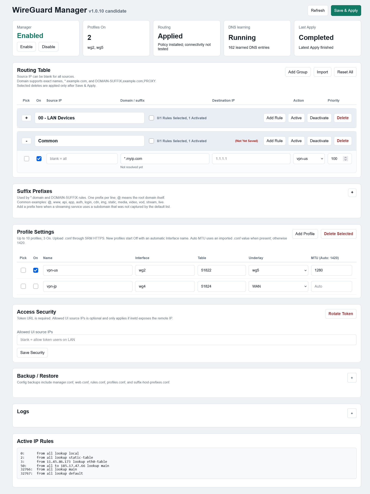

# WireGuard Client for Synology RT2600ac

**WireGuard Manager — a WireGuard VPN client with native Synology Router Manager (SRM) integration, multiple VPN profiles, and selective routing.**

I built WireGuard Manager to make WireGuard practical to use directly on the **Synology RT2600ac**. Instead of manually managing VPN tunnels and routing rules over SSH, you can import WireGuard configurations, manage profiles, and control which traffic goes through a VPN from an app on the SRM desktop.

The installation package includes the ARMv7 WireGuard components, the Manager service, and the SRM desktop app. **You do not need to compile or install WireGuard separately.**

**Current release:** [v1.0.10](https://github.com/ICHTBAA/WireGuard-Client-for-Synology-RT2600ac-Router/releases/tag/v1.0.10) (`1.0.10-1010` in SRM Package Center)  
**Tested platform:** Synology RT2600ac running **SRM 1.3.2-9366 Update 3**  
**Network scope:** Primary IPv4 LAN (`lbr0`)



*The screenshot uses anonymized example profiles, domains, and IP addresses.*

## Highlights

- **Native SRM app:** Manage WireGuard from the router's desktop interface.
- **Multiple VPN profiles:** Configure up to **10** profiles and run up to **3** at the same time.
- **Selective routing / split tunneling:** Send chosen LAN clients, destination IPs, or domains through a selected VPN profile.
- **Domain-based routing:** Match exact domains or domain suffixes, supported by DNS reply learning and periodic refresh.
- **Profile dependencies:** Configure an optional VPN underlay for a profile and handle dependent routes when a parent profile is disabled or removed.
- **Connection health monitoring:** Detect sustained outbound-only tunnel stalls and perform guarded recovery.
- **Per-profile MTU:** Import MTU settings from WireGuard configuration files or set an override in the app.
- **In-place upgrades:** Upgrade supported earlier versions through SRM Package Center while retaining profiles, rules, and keys.
- **Administrator access control:** Access the Manager through an authenticated SRM HTTPS gateway.

## Download

Download the **`.spk` installer** from **[Releases → v1.0.10](https://github.com/ICHTBAA/WireGuard-Client-for-Synology-RT2600ac-Router/releases/tag/v1.0.10)**.

> **Important:** Choose the `.spk` file under release assets, **not** GitHub's automatically generated *Source code (ZIP)* or *Source code (tar.gz)* files.

**Published installer**

```text
WireGuardManager-1.0.10-1010-RT2600ac-UNTESTED-c88266f54ee5.spk
```

**SHA-256**

```text
c88266f54ee5cd652ee95f871e9ab5bd844a6557863472cb69638da4d370a98f
```

This is the exact filename and checksum of the published installer. **I have fully tested v1.0.10 on my Synology RT2600ac.**

### Verify the download

On **Windows PowerShell**, run:

```powershell
(Get-FileHash -Algorithm SHA256 -LiteralPath 'C:\path\to\WireGuardManager-1.0.10-1010-RT2600ac-UNTESTED-c88266f54ee5.spk').Hash
```

Compare the result with the value above and [SHA256SUMS.txt](SHA256SUMS.txt). The values must match before installation.

## Requirements

- **Router:** Synology RT2600ac.
- **Firmware:** SRM 1.3.2-9366 Update 3 (tested configuration).
- A writable `/volume1` volume and a functioning TUN device.
- Access to **SRM Package Center** and an SRM account in the `administrators` group.
- **Root SSH access** for the one-time administrator binding step.
- **HTTPS access** to SRM for using the desktop app.
- `tcpdump` for IPv4 DNS reply learning on the primary LAN interface, `lbr0`.

Back up your router configuration and keep a separate way to access the router before changing routing rules.

## Fresh installation

### 1. Back up your router

Save a copy of your SRM settings and any existing VPN configuration or private keys.

A fresh installation starts with **Manager Off**, **no profiles**, and **no rules**. The installer does not overwrite an existing `/volume1/WireGuard` directory or private Manager state.

### 2. Install the SPK

1. Sign in to **Synology Router Manager (SRM)**.
2. Open **Package Center**.
3. Choose **Manual Install**.
4. Select the verified `.spk` file from the release.
5. Complete the installation wizard.

### 3. Bind your SRM administrator account

Connect to the router over SSH as `root` and run:

```sh
/bin/busybox sh /var/packages/WireGuardManager/target/share/configure-admin.sh YOUR_SRM_ADMIN_USERNAME
```

Replace `YOUR_SRM_ADMIN_USERNAME` with the SRM administrator account that will use WireGuard Manager.

Successful binding reports:

```text
admin_binding=PASS
```

The account must be a member of SRM's `administrators` group.

### 4. Open WireGuard Manager

1. Sign in to SRM **over HTTPS** using the bound administrator account.
2. Open **WireGuard Manager** from the SRM desktop.
3. Add your first WireGuard profile.

## Getting started

### Import and activate a WireGuard profile

1. Select **Add Profile** and import a WireGuard `.conf` file from your VPN provider or your own WireGuard server.
2. Review the imported configuration and MTU setting.
3. **Save the new profile while it is Off.** New profiles are assigned their own interface and policy table automatically.
4. Switch the saved profile **On** and save again.
5. **Enable Manager** to apply the configured routing behavior.
6. Add a selective routing rule and confirm that the chosen traffic uses the expected exit.

A newly imported profile must be saved **Off** before it can be switched **On**. Importing and activating it in a single save is intentionally blocked. Existing profile interface names cannot be renamed from the app.

### Set MTU

- If the imported `.conf` contains an MTU, the imported value is displayed and used.
- If no MTU is imported or explicitly set, **Auto** uses **1420**.
- You can enter a numeric MTU override for each profile.

Choose an MTU appropriate for your tunnel and WAN path if the default does not suit your connection.

## Selective routing and DNS learning

WireGuard Manager supports **selective IPv4 routing** based on:

| Rule type | What it matches |
| --- | --- |
| LAN source | Traffic originating from a selected LAN IPv4 source |
| Destination IP | Traffic sent to a specified IPv4 destination |
| Exact domain | A specific domain name |
| Domain suffix | Hostnames matching a configured domain suffix |

For domain rules, the Manager observes **plaintext IPv4 DNS replies** on the router's primary `lbr0` LAN and learns matching destination addresses. It also performs bounded periodic refreshes of enabled exact domains, configured suffix-prefix names, and previously learned hosts.

**Important routing behavior**

- Domain matching relies on IPv4 addresses that the router resolves or learns. Encrypted client-side DNS, cached answers, unobserved hostnames, and different CDN responses can prevent a new address from being learned immediately.
- Domain suffix rules do **not** enumerate every subdomain or every possible IP address.
- IPv6-only DNS answers are outside the Manager's selective IPv4 DNS-learning scope.
- **Applied** means the routing policy was installed; it is not an end-to-end connectivity test.
- A rule displaying **Not resolved yet** does not necessarily show every IP learned from observed subdomain DNS replies.

After adding or editing a rule, wait for **Apply** to finish, then test the selected traffic and confirm that ordinary Internet and SRM access still work.

## Profile dependencies and health monitoring

Each profile can have an optional underlay. If you turn a parent profile **Off** or delete it, directly dependent profiles' underlays and rules pointing to that profile are switched to **WAN** in the same save. Review the new traffic exit whenever you make such a change.

The background health worker monitors active profiles for sustained outbound-only stalls and performs guarded recovery. Provider-side outages, unavailable endpoints, and WAN connectivity problems may still need normal network troubleshooting.

## Upgrade from an earlier version

Version **1.0.10** supports in-place upgrades through Package Center from installed versions **`1.0.1-1001` through `1.0.9-1009`**.

**Version `1.0.0` is not included in this upgrade path.** Do not uninstall the existing package or rename `/volume1/WireGuard` as a workaround; first preserve your existing configuration and use an appropriate migration procedure.

To upgrade:

1. Make an external backup of your settings, WireGuard profiles, and private keys. Keep the previous SPK for recovery.
2. In WireGuard Manager, select **Disable** and wait until **Apply** finishes.
3. Open **SRM Package Center → Manual Install** and select the verified v1.0.10 SPK.
4. Complete the in-place upgrade. The upgrade process checks the installed package and live state, makes a private configuration snapshot, and updates package-owned components.
5. Reopen the SRM app and check your saved profiles, routing rules, keys, administrator binding, and network connectivity.
6. Re-enable Manager if you disabled it for the upgrade.

The supported upgrade process preserves profiles, rules, private keys, SRM administrator binding, and web tokens. It also checks for conditions that would make an upgrade unsafe, such as an active Apply operation or insufficient backup space.

**Same-version replacement:** SRM Package Center does not support replacing an installed package with different bytes under the same version number. If you are already running v1.0.10, do not reinstall solely for a documentation update.

## Disable, uninstall, and recovery

- **Disable Manager** to remove the routing policies managed by WireGuard Manager.
- Before uninstalling, **disable Manager** and wait for Apply to complete.
- Uninstalling the package **retains** `/volume1/WireGuard` and private SRM state for recovery. It does not erase your VPN configuration or keys.
- Because that state remains after uninstalling, a later fresh installation is **not** an automatic clean reset.
- Routing changes can briefly interrupt selected traffic. Keep your SRM recovery path available and change one set of rules at a time.

## Troubleshooting

**I imported a profile but cannot turn it on immediately.**  
Save the new profile while **Off**, then switch it **On** and save again. This is the required two-step activation process.

**A domain rule does not route all traffic for a website or service.**  
Check whether DNS answers are visible on `lbr0`, whether the client uses encrypted DNS, and whether the service uses multiple hostnames or CDN addresses. The DNS learner cannot automatically discover unseen hostnames.

**The rule says "Applied," but the service still does not connect.**  
Applied confirms that routing policy was installed. Check the WireGuard profile, endpoint reachability, DNS resolution, WAN connection, and destination service separately.

**A dependent profile or rule now uses WAN.**  
Check whether its parent profile was disabled or removed. Direct dependencies fall back to WAN when their parent is turned Off or deleted.

**The SRM app denies access.**  
Use HTTPS, sign in as the administrator bound during installation, and verify that the account belongs to the SRM `administrators` group. Direct HTTP access to the internal Manager service is blocked.

**Package Center will not install over my existing version.**  
Check the supported upgrade versions above. A same-version package replacement is not supported, and an existing private configuration directory cannot be silently overwritten by a fresh installer.

If you find an issue, include the **SRM version**, **package version**, **steps to reproduce**, and **redacted logs or screenshots** when opening a [GitHub issue](https://github.com/ICHTBAA/WireGuard-Client-for-Synology-RT2600ac-Router/issues). **Never share private keys, WireGuard configuration secrets, or manager web tokens.**

## Security and licensing

WireGuard Manager is accessed through an **authenticated HTTPS gateway** tied to a configured SRM administrator. Direct HTTP access to its internal service is denied.

The **Manager-specific code and SRM integration are not released under an open-source license**. Please read [LICENSE-MANAGER.md](LICENSE-MANAGER.md) before copying or distributing the package. It permits downloading and installing unmodified Manager-specific files on devices you own or administer, and private backups for that purpose, while reserving other rights.

WireGuard binaries and other independently licensed components retain their upstream licenses and rights. Their notices, source snapshots, and related materials are documented in [THIRD_PARTY.md](THIRD_PARTY.md) and included inside the SPK.

## Feedback

I built this project for RT2600ac users who want practical WireGuard profile management and selective routing inside SRM. If you use it, feedback is welcome:

- [Open an issue](https://github.com/ICHTBAA/WireGuard-Client-for-Synology-RT2600ac-Router/issues) for bugs or feature suggestions.
- [View releases](https://github.com/ICHTBAA/WireGuard-Client-for-Synology-RT2600ac-Router/releases) for downloadable packages and version information.
- If you find the project useful, consider giving the repository a **Star** to help other Synology router users discover it.

---

*Developed and tested for the Synology RT2600ac by [ICHTBAA](https://github.com/ICHTBAA). This is an independent project, not an official Synology or WireGuard product.*
