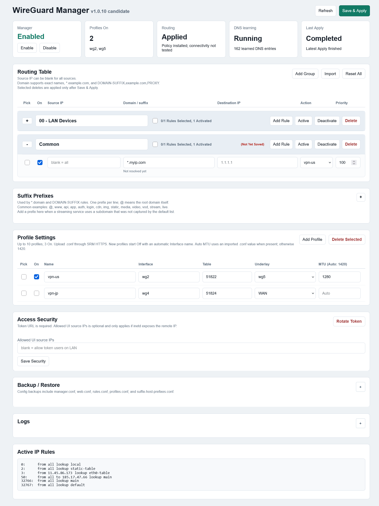

# Synology RT2600ac WireGuard Client

Current candidate: **1.0.10** (`1.0.10-1010` in SRM Package Center). The installer contains the ARMv7 WireGuard binaries, WireGuard Manager, and an SRM desktop App. Users do **not** need to build WireGuard separately.

**Tested hardware and firmware:** one Synology RT2600ac running SRM 1.3.2-9366 Update 3. On that Router, the owner verified an earlier 1.0.10 archive: in-place upgrade, preserved profiles/rules/private keys, Manager and profile enable/disable, rule/profile add/delete, action changes, changed and unchanged saves, intended VPN connectivity, imported MTU 1360, automatic MTU 1420, and denial of Manager access to unauthenticated and non-administrator users. The candidate below is a documentation-only repack: archive comparison confirmed that **only its embedded README changed**; all runtime and installer files match the Router-tested copy. The repacked archive itself was not installed on the Router. This is **not** a second-device fresh-install test, independent security audit, or failed-upgrade rollback test. Keep an external backup and recovery access.



The screenshot is anonymized and illustrative: its profile names, sample domain, and visible IP addresses are not a release test record.

## Download and verify

Download the SPK from **[Releases → v1.0.10](https://github.com/ICHTBAA/WireGuard-Client-for-Synology-RT2600ac-Router/releases/tag/v1.0.10)**, not GitHub's automatic source-code ZIP/TAR. The documentation-corrected candidate, with the same runtime payload as the Router-tested copy, is:

```text
WireGuardManager-1.0.10-1010-RT2600ac-UNTESTED-c88266f54ee5.spk
SHA-256: c88266f54ee5cd652ee95f871e9ab5bd844a6557863472cb69638da4d370a98f
```

The `UNTESTED` filename is retained because full release gates remain open; it does **not** mean the single-Router checks above were skipped. Check the downloaded archive before installation:

```powershell
(Get-FileHash -Algorithm SHA256 -LiteralPath 'C:\path\to\WireGuardManager-1.0.10-1010-RT2600ac-UNTESTED-c88266f54ee5.spk').Hash
```

Compare the entire hash with [SHA256SUMS.txt](SHA256SUMS.txt). Do not rename or rebuild the archive and assume it is the same documented candidate.

## Requirements

- RT2600ac with SRM, a writable `/volume1`, and a working TUN device.
- HTTPS SRM access, an SRM administrator, and root SSH access for one-time administrator binding.
- `tcpdump` for learning IPv4 DNS replies on the primary `lbr0` LAN.
- An independent way to recover Router access and settings if policy routing is misconfigured.

The reviewed target is one primary `lbr0` IPv4 LAN. Other Router models and multi-LAN configurations are not validated.

## Fresh installation

1. Back up SRM settings and any existing VPN configuration and keys. The fresh installer refuses an existing `/volume1/WireGuard` tree or private Manager state; it does not silently adopt or overwrite them.
2. In **SRM Package Center → Manual Install**, select the hash-verified SPK. A fresh install starts with Manager Off, no profiles, and no rules.
3. SSH to the Router as root and bind the SRM administrator who will use the App:

   ```sh
   /bin/busybox sh /var/packages/WireGuardManager/target/share/configure-admin.sh YOUR_SRM_ADMIN_USERNAME
   ```

   Expect `admin_binding=PASS`. The account must belong to SRM's `administrators` group. Do not publish the generated Web token, private gateway keys, or VPN `.conf` files.
4. Sign in to SRM **over HTTPS** as that administrator and open **WireGuard Manager** from the SRM desktop.
5. Use **Add Profile** to import a WireGuard `.conf`. A new profile starts Off with an automatically assigned interface/table; save it **while Off first**. Importing and switching it On in the same save is deliberately rejected. The interface name of an existing profile cannot be renamed in the UI.
6. Turn the saved profile On and save, then enable Manager. Add one selective rule and verify the intended exit, normal Internet, and SRM access before adding broader rules.

An imported `.conf` MTU is shown in the profile's MTU field after Save. Without an imported value or explicit override, `Auto` uses **1420**. A numeric profile override can be set in the UI; the correct MTU depends on the uplink and tunnel path.

## Package Center upgrade

This 1.0.10 package supports a reviewed in-place upgrade from installed `1.0.1-1001` through `1.0.9-1009`; upgrading the same package version with different bytes is **not** supported. A 1.0.0 installation is not in this allowlist and requires a separate reviewed migration. Do not uninstall or rename `/volume1/WireGuard` as an upgrade shortcut.

1. Verify the new SPK and a private, external backup of the current configuration and keys. Retain the old SPK for recovery.
2. In Manager, **Disable**, and wait until Apply finishes. In Package Center, choose **Manual Install** and select the 1.0.10 SPK as an upgrade. Profiles and rules do not need to be deleted.
3. The upgrade preflight checks the package and live state, snapshots private configuration, and swaps package-owned code. It is intended to preserve profiles, rules, keys, SRM binding, and Web tokens. It refuses an unsupported source version, active Apply, changed directory identity, or insufficient backup space.
4. Reopen the SRM App and verify the saved profiles/rules, normal Internet, SRM access, and one intended VPN route. Enable Manager again if it was disabled. Retain the backup until acceptance is complete.

Preservation on a successful upgrade was checked on one Router. **Automatic rollback after an interrupted or failed upgrade has not been tested on hardware.**

## Features and operating model

- Up to **10** configured profiles and **3** On profiles. Each profile has an automatically assigned interface and policy table, optional underlay, and optional MTU override.
- Selective IPv4 routing by LAN source, destination IP, exact domain, or domain suffix. The UI groups rules and shows profile, routing, DNS-learning, and last-Apply status.
- DNS learning observes plaintext IPv4 DNS replies on `lbr0` and adds policy for matching learned addresses. A bounded periodic refresh revisits enabled exact names, configured suffix-prefix names, and previously learned hosts. Suffix rules do not enumerate every possible hostname or IP.
- Turning a parent profile Off or deleting it switches directly dependent profiles' underlays and rules targeting that profile to WAN in the same Save. Review the resulting traffic exit before applying.
- A health worker checks active profiles for sustained outbound-only stalls and uses guarded recovery; an external VPN-provider or uplink failure can still require separate diagnosis.
- The SRM App uses an authenticated HTTPS gateway. Direct HTTP access to the internal Manager service is denied.

The **Applied** status means policy was installed, not that the destination service or VPN exit passed a connectivity test. `Not resolved yet` in a rule row is not a complete view of event-learned subdomain IPs.

## Limitations and recovery

- Domain policy covers only IPv4 addresses the Router resolves or learns. Client-side encrypted DNS, pre-existing client caches, unseen subdomains, different CDN answers, and IPv6-only answers can bypass immediate learning. Prefixes are a bounded hint, not wildcard enumeration.
- A profile or rule change can briefly affect its selected traffic. Wait for Apply completion before making the next change; keep Router recovery access available.
- **Disable Manager** removes Manager-owned routing policy. An enabled Manager must be disabled before uninstall. Uninstall retains `/volume1/WireGuard` and private SRM state for recovery; a later fresh installation will therefore not be an automatic reset.
- The README embedded in this candidate correctly describes 1.0.10 and the 1.0.1–1.0.9 upgrade range. Router owners already running the earlier 1.0.10 archive do not need to reinstall for this documentation correction. Package Center does not support a same-version replacement; the two archives have different SHA-256 values and must not be confused.
- This package is a single-Router candidate, not a security certification or guarantee for all SRM configurations.

## Licensing and third-party source

[LICENSE-MANAGER.md](LICENSE-MANAGER.md) permits installing unmodified Manager-specific files but does not grant modification or independent redistribution rights. The separately licensed WireGuard components retain their own rights; see [THIRD_PARTY.md](THIRD_PARTY.md). Their source snapshots, notices, and relinkable objects are inside the SPK under `third_party/`.
